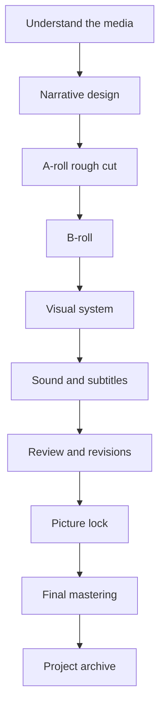
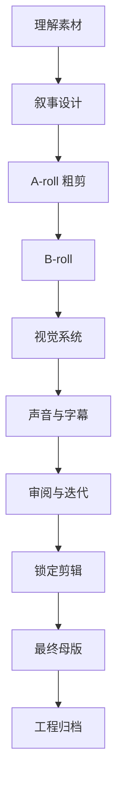

# 001 · AI-assisted Filmmaking / AI 辅助影视创作

[English](#english) · [简体中文](#简体中文)

## English

**V1.0 · Human-directed, AI-assisted**

This workflow grew out of a roughly six-minute human-interest documentary centered on a real interview. It is intended for documentary shorts, interview-led videos, and small nonfiction projects whose creators can review staged edits. The filmmaker owns the story, aesthetic decisions, and approval gates. The agent helps with file and timeline analysis, execution, and verification where its environment permits.

### Production flow

### Prerequisites and use

1. Identify the source media, permitted file access, target runtime and format, and review checkpoints. Confirm rights to music, images, and footage before distribution.
2. Verify the available tools. FFmpeg and FFprobe can support media inspection and rendering, transcription tools can draft captions, and a compatible editor is needed for editable project delivery. Use available tools that fit the job.
3. Copy the [English master prompt](master-prompt.en.md) or the [original Chinese version](master-prompt.zh-CN.md) and fill in the project brief. Begin with media analysis and a reviewable A-roll. Record frame rate, keep the originals read-only, and preserve a baseline.
4. Use the [bilingual revision template](revision-template.md) to request targeted changes. Before final delivery, lock the approved cut and distinguish automated checks from playback review.

### Limits

The consolidated prompt draws on one documentary production and has yet to be validated across other genres, models, and editing environments. Inspect captions and asset rights yourself. An editor may import timeline interchange files with limited support for native effects and text. Check actual playback and re-open the project in the target editor. The English text is an AI-assisted translation of the Chinese source and awaits further practical validation.

[Workflow changelog](CHANGELOG.md) · [Library home](../../README.md#english)

---

## 简体中文

**V1.0 · 人类主导，AI 协作**

这套流程源于一部约六分钟的真实人物采访纪录短片，适用于能分阶段审阅的纪录短片、访谈视频和小型纪实项目。创作者决定叙事、审美和验收节点，Agent 在工具允许的范围内协助分析文件与时间线、执行制作和验证结果。

### 制作流程

### 技术条件与使用方法

1. 明确原始素材、文件访问权限、目标时长与格式，以及需要审阅的节点。分发前检查音乐、图片和视频授权。
2. 检查可用工具。FFmpeg 和 FFprobe 可用于分析和渲染，转录工具可生成字幕草稿，可编辑工程需要相应软件支持。按项目的实际条件选择工具。
3. 复制[中文版 Master Prompt](master-prompt.zh-CN.md)或[英文版](master-prompt.en.md)，填写项目需求。从素材分析和可审阅的 A-roll 开始，记录时间线帧率，只读保护原始素材并保留基准版本。
4. 用[双语迭代模板](revision-template.md)提出局部修改。最终交付前先锁定已批准的剪辑，并区分自动化检测与人工播放审阅。

### 已知局限

通用 Prompt 由一次真实纪录短片实践提炼，尚待在不同类型、模型和剪辑环境下验证。字幕和素材许可需要人工确认。交换格式在不同软件中对特效和文字的支持有限，应在目标剪辑软件中实际打开工程并检查播放。英文版为基于中文原稿的 AI 辅助翻译，仍待进一步实践验证。

[工作流更新日志](CHANGELOG.md) · [返回仓库首页](../../README.md#简体中文)
